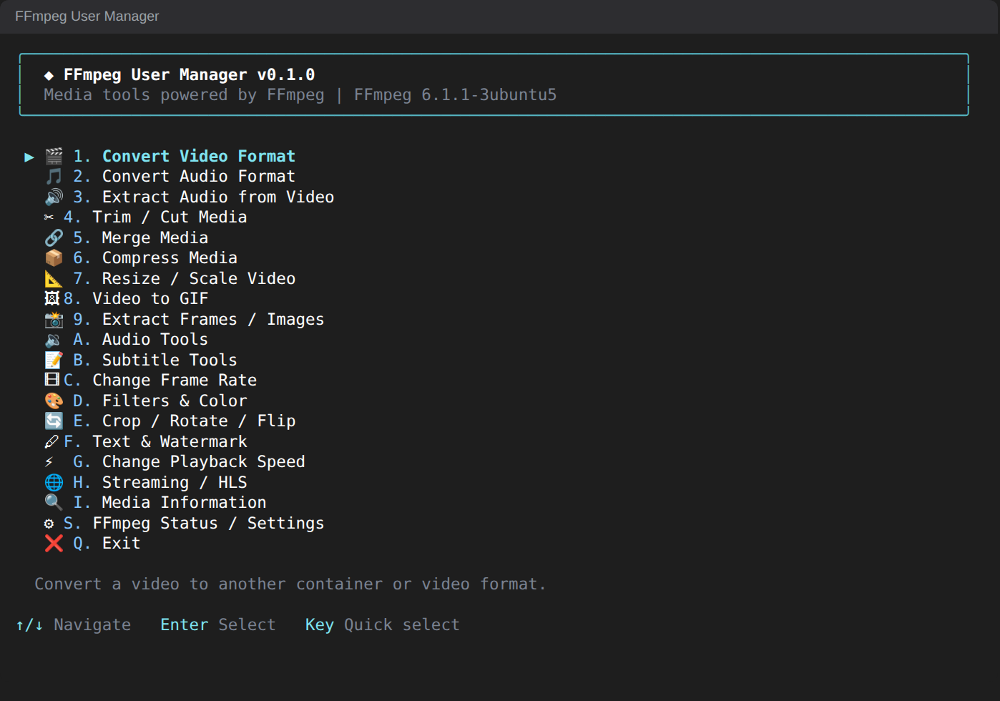
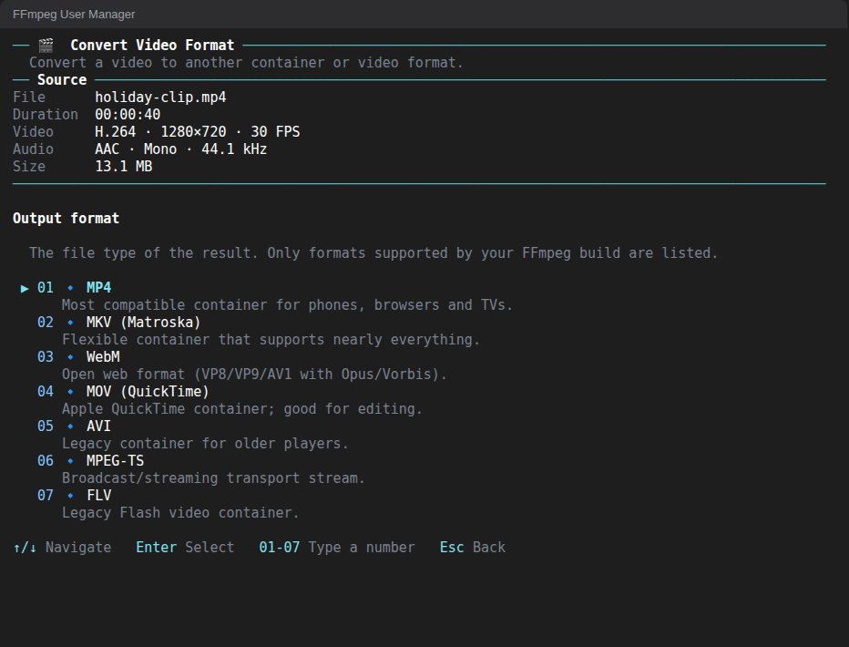
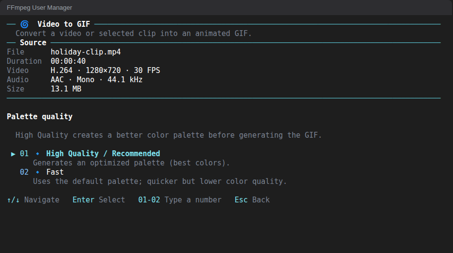
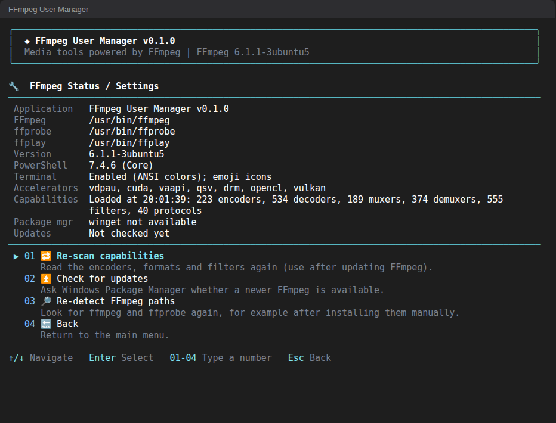
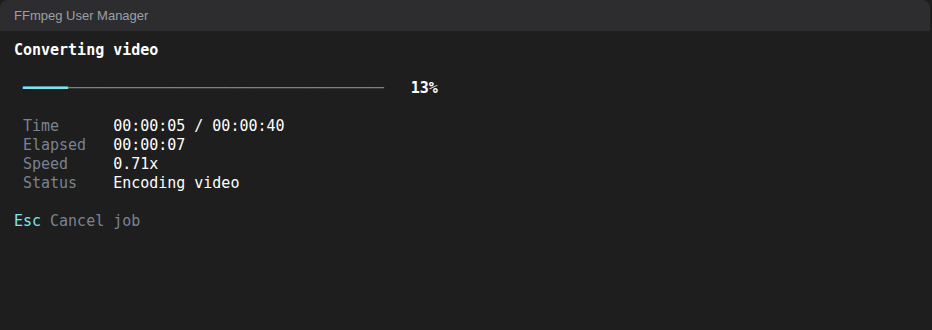
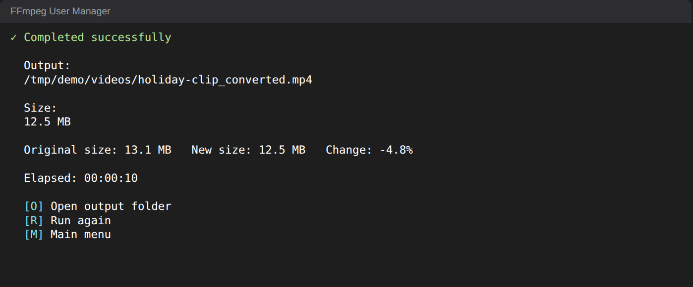
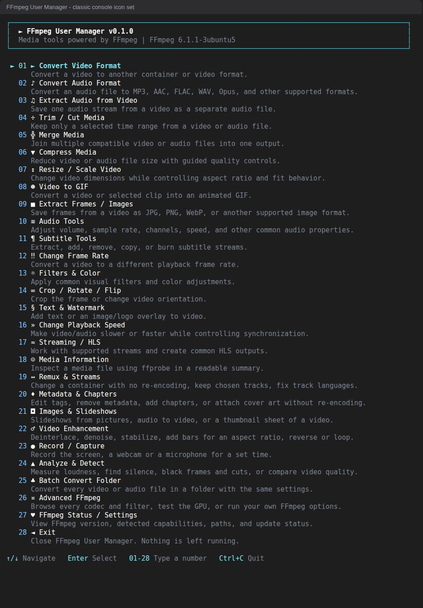

<div align="center">

# FFmpeg User Manager

**A modern interactive PowerShell TUI for FFmpeg on Windows.**
Convert, compress, trim, merge, extract, resize, make GIFs, slideshows and recordings, manage subtitles, metadata and streams, analyze and batch-process media - without writing FFmpeg commands.


</div>

<p align="center">
  
</p>

## Overview

FFmpeg User Manager turns FFmpeg into a guided, keyboard-driven terminal application. You pick what you want to do, answer a few plain-English
questions (mostly multiple choice, with sensible defaults and short explanations), review a summary, and the app builds and runs the correct FFmpeg command for you.

It detects FFmpeg, offers to install or update it through Windows Package Manager (`winget`), inspects your file with `ffprobe`,
and only offers options that **your installed FFmpeg build actually supports**.

### Why this project exists

FFmpeg can do almost anything with audio and video, but remembering its command syntax is hard - especially for filters, codecs, palettes and stream mapping.
This project gives beginners a safe, visual way to use the common 95% of FFmpeg, and gives experienced users a fast way to avoid looking up the same commands again.

### Typical use cases

* Turn a screen recording or clip into a small, good-looking **GIF**.
* **Compress** a large video for sharing, or aim for an approximate file size.
* **Convert** between MP4, MKV, WebM, MOV and audio formats; **extract** audio or frames.
* **Trim**, **merge**, **resize**, **crop/rotate/flip**, change **speed** or **frame rate**.
* Add **subtitles**, **text** or a **logo**, normalize **loudness**, create **HLS** output.
* Change a container **without re-encoding**, pick audio languages, edit **metadata and chapters**, embed cover art.
* Build a **slideshow** or time-lapse from pictures, turn audio into video, **record** the screen, a webcam or a microphone (Windows).
* **Analyze** a file (volume, loudness, silence, black frames, scene cuts, quality), **batch-convert** a whole folder, or reach any other FFmpeg feature through **Advanced FFmpeg**.

## Preview

| Wizard question | Video to GIF |
|---|---|
|  |  |

| FFmpeg status | Progress | Result |
|---|---|---|
|  |  |  |

| Classic console icon set |
|---|
|  |

> The screenshots are real frames of the running application, captured in a Linux terminal (see [docs/images/README.md](docs/images/README.md)). Windows Terminal looks very similar.
> The last one shows the symbol icon set that the classic Windows console uses, so icons are visible even where emoji cannot be drawn.

## Key features

* **Guided wizards for every task** - questions, validation, summary, progress and result screens, with *Back* at every step.
* **Numbers, not shortcuts** - every option is `Number  Icon  Name` (`01`, `02` ... `09`, `10`, `11` ... `100`), with a short description underneath; no letter keys to memorize.
* **Icons that always show** - emoji in modern terminals, single-column symbols in the classic Windows console, plain tags only when output is redirected.
* **Multiple choice first** - free typing only where a value is truly free-form (with an example and an explanation shown).
* **Capability-aware** - encoders, formats, filters and hardware accelerators are discovered from your FFmpeg build; unsupported options are not offered.
* **Automatic FFmpeg management** - detect, install and update FFmpeg with winget; a manually installed FFmpeg is never replaced silently.
* **Smart media inspection** - the source file is probed and summarized (codecs, size, frame rate, audio, subtitles) before you choose anything.
* **Safe by design** - existing files are never overwritten without asking; source files are never modified; commands are passed to FFmpeg as argument arrays (no shell, no `Invoke-Expression`).
* **Polished terminal UI** - colors, icons (emoji, console-safe symbols or ASCII), progress bar, responsive layout, clean terminal restore on exit.
* **Windows PowerShell 5.1 and PowerShell 7.x** from one code base.

## Supported operations

| Area | What you can do |
|---|---|
| **Convert video** | MP4, MKV, WebM, MOV, AVI, MPEG-TS, FLV; codec, quality or bitrate, preset, resolution, frame rate, audio, subtitles, metadata, hardware options |
| **Convert audio** | MP3, AAC/M4A, FLAC, WAV, Opus, OGG, AC-3, MKA; bitrate or VBR, sample rate, channels |
| **Extract audio** | Copy or convert a chosen audio track, optionally only a time range |
| **Trim / cut** | Fast (stream copy) or accurate (re-encode) cuts for video and audio |
| **Merge** | Lossless concatenation when compatible, otherwise re-encode to common settings; reorderable list |
| **Compress** | Smaller file, quality target, bitrate, or approximate target size; video and audio |
| **Resize / scale** | Presets or custom size; preserve aspect, fit, fill/crop or stretch |
| **Video to GIF** | Clip range, FPS, speed, size (from 320 px up to 1080 / 2K / 4K / 8K wide, or custom), high-quality palette, dithering, loop control |
| **Extract frames** | Single frame, interval, FPS or range as PNG / JPEG / WebP / BMP / TIFF |
| **Audio tools** | Volume, loudness normalization (two-pass), sample rate, channels, tempo/speed, remove or replace audio, fades, bass/treble, noise reduction, silence removal, frequency filters, sync offset, reverse |
| **Subtitle tools** | Extract, add (mux), burn in, remove, keep selected streams |
| **Frame rate** | Standard conversion or motion interpolation |
| **Filters & color** | Brightness, contrast, saturation, gamma, grayscale, sharpen, blur, fades, expert filter, filter browser |
| **Crop / rotate / flip** | Aspect presets or exact crop; 90/180/custom rotation; flips |
| **Text & watermark** | Text with position/color/box/timing; logo overlay with size/opacity/timing |
| **Playback speed** | 0.25x-10x with synchronized audio |
| **Streaming / HLS** | Create HLS playlists and segments; save or inspect supported network streams |
| **Media information** | Readable summary plus technical details |
| **Remux & streams** | Change container without re-encoding, keep selected streams, set track language / default |
| **Metadata & chapters** | Edit tags, remove metadata/chapters, add chapters, attach cover art |
| **Images & slideshows** | Slideshow from pictures (with music), image sequence to video, audio to video (cover, waves, spectrum), contact sheet |
| **Video enhancement** | Deinterlace, denoise, stabilize, add bars for an aspect ratio, reverse, loop |
| **Record / capture** | Screen, webcam and microphone recording for a set time (Windows) |
| **Analyze & detect** | Volume, loudness, silence, black frames, scene changes, black bars, PSNR/SSIM quality comparison |
| **Batch convert** | One conversion applied to every video or audio file in a folder |
| **Check & maintain** | Guided health check of the FFmpeg setup: install/repair FFmpeg, check for updates, emoji font, icon style, capability re-scan - each step explained and asked first |
| **Advanced FFmpeg** | Capability browser (all encoders, filters, formats...), custom command, GPU check, build details |
| **FFmpeg status** | Paths, version, capabilities, hardware accelerators, update check |
| **Streaming / HLS** | (also) send a file out to an RTMP / SRT / UDP address |

Every option of every workflow is described in [docs/Workflows.md](docs/Workflows.md).

## Requirements

| Item | Requirement |
|---|---|
| Operating system | Windows 10 or 11 |
| PowerShell | Windows PowerShell 5.1 (built into Windows) **or** PowerShell 7.x - PowerShell 7 is preferred automatically when installed |
| FFmpeg | `ffmpeg` and `ffprobe` on `PATH`. Not installed yet? The app offers to install them with winget (package `Gyan.FFmpeg`) |
| Terminal | Windows Terminal recommended (colors and emoji icons). The classic console works too and shows symbol icons. The PowerShell ISE is not supported |
| Internet | Only for installing/updating FFmpeg and for network streams |

## Installation

1. **Get the project** - either
   * download `FFmpeg-User-Manager-vX.Y.Z.zip` from the *Releases* page (recommended) or the repository ZIP (*Code -> Download ZIP*) and extract it completely, or
   * clone it:
     ```powershell
     git clone https://github.com/Abdulrahman3M/FFmpeg-User-Manager.git
     ```
2. If you downloaded a ZIP, right-click the ZIP -> *Properties* -> *Unblock* before extracting (or run `Get-ChildItem -Recurse . | Unblock-File` in the folder).
3. That is all - no installer is needed. FFmpeg is detected (and can be installed) on first start.

## Quick Start

1. Open the project folder.
2. **Double-click `FFmpeg-User-Manager.bat`.**
3. The app checks FFmpeg automatically (and offers to install or update it if needed).
4. Pick an action from the main menu and follow the questions.

## BAT launcher

`FFmpeg-User-Manager.bat` is the recommended Windows entry point. You do not have to type any PowerShell command.

* It finds its own folder, so it works from Explorer, Command Prompt, PowerShell or Windows Terminal, in folders with spaces or parentheses.
* It starts `Start-FFmpegTUI.ps1` with **PowerShell 7 (`pwsh.exe`) if available, otherwise Windows PowerShell 5.1**.
* It uses a process-scoped `-ExecutionPolicy Bypass` for that single run only; your machine or user execution policy is never changed.
* It passes arguments through (for example `FFmpeg-User-Manager.bat -SkipUpdateCheck`) and returns the application's exit code.
* It contains launcher logic only. FFmpeg detection, installation, updates and all media logic live in the PowerShell application.

Advanced: set the environment variable `FFUM_POWERSHELL` to a full path to force a specific PowerShell, or `FFUM_TRACE=1` to print which one is used.

**Manual start (secondary method):**

```powershell
.\Start-FFmpegTUI.ps1                   # start the application
.\Start-FFmpegTUI.ps1 -SkipUpdateCheck  # skip the FFmpeg update check at startup
.\Start-FFmpegTUI.ps1 -Version          # print the version and exit
```

If scripts are blocked: `powershell -ExecutionPolicy Bypass -File .\Start-FFmpegTUI.ps1`.

## How it works

Every workflow is an interactive **wizard** built from the same reusable steps:

1. **Choose the input** - type, paste or drag a path (quotes, spaces and Unicode are fine). Press `Tab` for the Windows file picker.
2. **The file is inspected** with `ffprobe`; a *Source* panel stays visible while you answer.
3. **Answer questions** - type an option's number (or use the arrow keys and `Enter`); custom values are validated and explained. `Esc` goes back and keeps your earlier answers.
4. **Choose the output** - folder, file name, and what to do if the file already exists (you are always asked).
5. **Review the summary** - option `02` shows the exact FFmpeg command (Advanced), `01` (or `Enter`) starts.
6. **Watch the progress** - percentage, time, speed; `Esc` cancels safely after confirmation.
7. **Result** - open the output folder, run again, or return to the menu. On failure you get a short reason and optional technical details.

## Keyboard controls

Every option is numbered: the number is the shortcut, and there are no letter keys.

| Key | Action |
|---|---|
| `0`-`9` | Type an option's number: `05` selects option 5 at once. A single digit that cannot start a longer number (for example `5` in a list of 12) also selects at once; for a prefix such as `1` in a list of 12, type the next digit or press `Enter`. `Backspace` removes a typed digit |
| `Up` / `Down` | Move the highlight (`Home` / `End` / `PgUp` / `PgDn` jump) |
| `Enter` | Select the highlighted option / accept the default |
| `Esc` | Back one step (answers are kept) |
| `Ctrl+C` | Quit the application |
| `Tab` | Browse for a file or folder (path questions, Windows) |
| `Ctrl+U` | Clear the text field |

Yes/No questions are numbered like everything else: `01` and `02`.

## Workflow examples

<details>
<summary><b>Make a small, good-looking GIF from a video clip</b></summary>

1. Main menu -> `08` *Video to GIF* -> enter the video path.
2. *Clip range*: choose `02` *Start time + end time* and enter for example `5` and `9`.
3. Accept 15 FPS and a 480 px width (or pick your own), keep *High Quality* palette, infinite loop.
4. Choose the output folder/name -> `Enter` on the summary. The GIF is created with a generated color palette for better quality.

</details>

<details>
<summary><b>Compress a video to about 25 MB</b></summary>

1. Main menu -> `06` *Compress Media* -> input file.
2. *Compression goal*: *Approximate target file size* -> `25`.
3. Keep the automatic codec, optionally reduce resolution -> start. The bitrate is calculated from the duration; the final size is approximate.

</details>

<details>
<summary><b>Extract the audio of a video as MP3</b></summary>

1. Main menu -> `03` *Extract Audio from Video* -> input.
2. Choose *Convert*, output format *MP3*, pick bitrate -> start.

</details>

<details>
<summary><b>Join several clips</b></summary>

1. Main menu -> `05` *Merge Media*: add files in order (reorder/remove any entry).
2. If the clips share codecs and settings you can merge losslessly; otherwise the app explains why and re-encodes to common settings.

</details>

## FFmpeg management

* **Detection** - `ffmpeg` and `ffprobe` are located and actually executed; a stale `PATH` entry is not accepted as an installation.
* **Missing** - a screen offers *Install automatically* (winget package `Gyan.FFmpeg`, verified before installing) or *Exit*. The main menu opens only after a working pair is verified.
* **Updates** - when FFmpeg is managed by winget, a quick check offers *Update now* / *Continue*. If the check cannot run (offline, no winget, manually installed FFmpeg) you get a short non-fatal notice.
* **Manual installs** are used as they are and never replaced silently.
* **Capabilities** - formats, encoders, filters, protocols and hardware accelerators are read from your build once per session; see them on the *FFmpeg Status / Settings* screen (`27`).

## Project structure

```text
FFmpeg-User-Manager/
|-- FFmpeg-User-Manager.bat     Windows launcher (double-click)
|-- Start-FFmpegTUI.ps1         PowerShell entry point
|-- VERSION                     single source of the application version
|-- README.md  CHANGELOG.md  AGENTS.md
|-- LICENSE  NOTICE             Apache-2.0 license text and attribution notice
|-- config/defaults.json        application defaults (presets, winget package id)
|-- src/
|   |-- Core/                   app bootstrap, environment, paths, validation, process runner
|   |-- TUI/                    theme, renderer, input, menu, dialogs, wizard, progress view
|   |-- FFmpeg/                 manager, capabilities, media probe, command builder, progress
|   `-- Workflows/              one module per workflow group (+ shared WorkflowCommon)
|-- docs/                       architecture, workflows, testing, versioning, licensing, images
|-- tests/                      unit and smoke tests (Run-Tests.ps1)
`-- tools/New-ReleasePackage.ps1  builds the release ZIP
```

## Versioning

This project follows [Semantic Versioning](https://semver.org/spec/v2.0.0.html): `MAJOR.MINOR.PATCH`.

* **MAJOR** - breaking changes
* **MINOR** - backward-compatible features
* **PATCH** - backward-compatible fixes

Release tags use the format `vX.Y.Z` (for example `v0.1.0`). The version lives in the [`VERSION`](VERSION) file and is shown in the application header.
Details, pre-release labels and the release checklist: [docs/Versioning-and-Releases.md](docs/Versioning-and-Releases.md). Changes are listed in [CHANGELOG.md](CHANGELOG.md).

## Releases

Official releases are published on the repository's *Releases* page as `FFmpeg-User-Manager-vX.Y.Z.zip`; the notes of each release summarize its features, fixes and known limitations.
The current release is **v0.1.0** (see [CHANGELOG.md](CHANGELOG.md)). To use a release, download the ZIP, extract it completely and follow [Installation](#installation).

## Documentation

| Document | Content |
|---|---|
| [docs/Workflows.md](docs/Workflows.md) | Every workflow and its questions/options |
| [docs/Architecture.md](docs/Architecture.md) | Modules, TUI and wizard design, FFmpeg engine |
| [docs/Testing.md](docs/Testing.md) | Test suite, compatibility matrix, manual checks |
| [docs/Versioning-and-Releases.md](docs/Versioning-and-Releases.md) | SemVer rules, tags, changelog and release process |
| [docs/Licensing.md](docs/Licensing.md) | Why Apache-2.0, what it means, third-party components review |
| [docs/images/README.md](docs/images/README.md) | How the screenshots were captured |
| [CHANGELOG.md](CHANGELOG.md) | Version history |
| [AGENTS.md](AGENTS.md) | Working rules for AI agents and contributors |

## Troubleshooting

| Symptom | What to do |
|---|---|
| Double-clicking does nothing / window closes | Start `FFmpeg-User-Manager.bat` from a terminal to see messages. Make sure the whole folder was extracted and `Start-FFmpegTUI.ps1` sits next to the `.bat` |
| "FFmpeg was not found." | Choose *Install FFmpeg automatically* (winget), or install FFmpeg yourself, open a **new** terminal and choose *Retry* |
| "ffmpeg cannot be started" | A stale `PATH` entry points to a missing or broken ffmpeg; fix it and choose *Retry* |
| Installation or update reports an administrator problem | Run the terminal as Administrator or install FFmpeg manually |
| Blocked script / "running scripts is disabled" | Use the `.bat` launcher (it needs no policy change) or `powershell -ExecutionPolicy Bypass -File .\Start-FFmpegTUI.ps1`; unblock downloaded files (see Installation) |
| Icons look odd or colors are garbled | Icons are characters, so they depend on the terminal font. The app picks emoji (Windows Terminal), single-column symbols (classic console) or ASCII tags automatically; the app offers emoji once on first start and remembers your answer (change it in *FFmpeg Status / Settings*); force one with `FFTUI_ICONS=emoji`, `symbol` or `ascii`, and plain colors with `FFTUI_NO_ANSI=1`. Use a TrueType console font (Consolas, Cascadia) rather than a raster font |
| "needs an interactive console" | Start it from a real terminal window (not a pipe/redirect, not the ISE) |
| An option is missing | Your FFmpeg build does not include that encoder/filter - check *FFmpeg Status / Settings* |
| Text overlay fails | The `drawtext` filter needs FreeType and a font; choose a font file in the *Font* question |
| Conversion fails | Choose *Show technical details* on the failure screen; the message explains most cases (unsupported codec/format combination, damaged input, no disk space) |

## License

FFmpeg User Manager is free and open source under the **[Apache License 2.0](LICENSE)**. You may use, change and redistribute it, including commercially, as long as you keep the
copyright notice, the license and the [`NOTICE`](NOTICE) file and mark files you changed. The software is provided "as is", without warranty. Copyright 2026 Abdulrahman3M.

FFmpeg itself is **not** part of this project and is not distributed with it: the application starts the copy installed on your computer, which has its own license (see
[docs/Licensing.md](docs/Licensing.md) for the license decision and the third-party review).

## Project status

**Pre-release series (version 0.x), first release v0.1.0.** All workflows listed above are implemented. The automated suite (more than 1,300 checks) passes on **Windows PowerShell 5.1** and on **PowerShell 7** on a
GitHub-hosted Windows runner (FFmpeg 9.0.2) and on PowerShell 7.4 on Linux (FFmpeg 6.1); the launcher is tested with the real `cmd` interpreter.
**Not yet verified by any automated run and therefore not claimed:** rendering in a real Windows Terminal / classic console, real `winget` installs and updates, the native file picker and Explorer integration,
and screen / webcam / microphone recording on real devices. `tools/Test-WindowsLocal.ps1` lists these checks. Version 1.0.0 is reserved until they are done (see
[docs/Versioning-and-Releases.md](docs/Versioning-and-Releases.md)). Details: [docs/Testing.md](docs/Testing.md).
